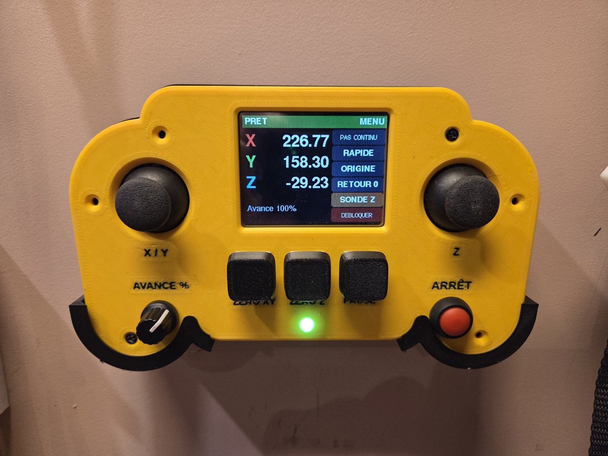
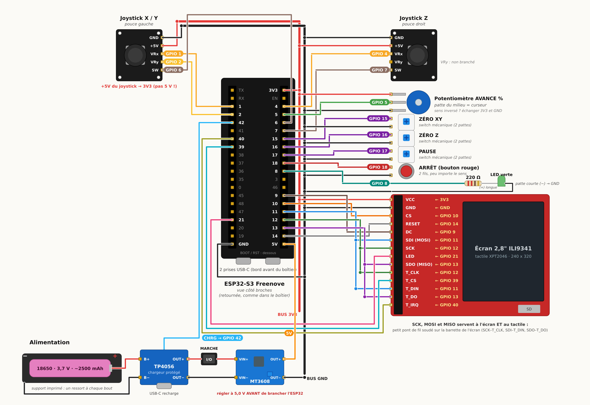

# Télécommande Wi-Fi pour CNC GRBL – TwoTrees TTC450

Télécommande sans fil (pendant) en forme de manette pour piloter une CNC GRBL en Wi-Fi.
Conçue pour la **TwoTrees TTC450** (carte **MKS DLC32**), elle marche avec toute carte GRBL joignable en Wi-Fi (port 8080 ou 23).

## Fonctions
- Joystick gauche : X / Y. Joystick droit : Z.
- Écran tactile 2,8" : position X / Y / Z en direct, pas à pas ou continu, rapide / lent, origine, retour à zéro, déblocage.
- Palpage Z automatique avec une plaque de sonde (épaisseur réglable, 19 mm par défaut).
- Boutons ZÉRO XY, ZÉRO Z, PAUSE et ARRÊT ; potentiomètre d'avance (%).
- Menu : choix du Wi-Fi avec clavier, recherche automatique de la CNC, IP modifiable, calibrage de l'écran, sens des joysticks, test du câblage.
- Batterie 18650 rechargeable en USB-C, voyant qui « respire » pendant la charge, niveau de batterie à l'écran.
- Mises à jour par le Wi-Fi (ArduinoOTA).
- Support mural : la télécommande reste en charge quand elle est accrochée.
- **Mode imprimante 3D** (Creality K2 / Klipper, via Moonraker port 7125) : MENU → bouton « MACHINE ». Déplacements tête/plateau (bloqués pendant une impression), origine G28, préchauffe PLA, pause / reprise, annulation, arrêt d'urgence, vitesse d'impression au potentiomètre, températures et progression à l'écran.

## Contenu du dépôt
| Dossier | Contenu |
|---|---|
| `firmware/Telecommande_CNC/` | Programme Arduino (`.ino`) |
| `boitier/` | Fichiers OpenSCAD paramétriques (boîtier, support mural) |
| `stl/` | Pièces à imprimer (STL) et façade 2 couleurs pour Creality K2 / CFS (3MF) |
| `images/` | Photos, schéma de câblage, détail charge / batterie |

## Matériel
- ESP32-S3 Freenove WROOM (8 Mo)
- Écran SPI 2,8" ILI9341 + tactile XPT2046
- 2 joysticks analogiques (KY-023), 3 switchs MX, 1 bouton poussoir Ø12
- 1 potentiomètre, 1 LED 5 mm + résistance 220 Ω
- Chargeur TP4056 USB-C avec protection, élévateur MT3608 réglé sur 5 V
- Pile 18650 + 2 ressorts Ø7 mm, interrupteur à bascule
- 2 résistances 100 kΩ (mesure de la batterie)

## Brochage (ESP32-S3)
| Fonction | GPIO |
|---|---|
| Joystick X / Y / Z | 1 / 2 / 4 |
| Potentiomètre avance | 5 |
| Boutons PAS / VITESSE | 6 / 7 |
| LED | 8 |
| ZÉRO XY / ZÉRO Z / PAUSE / ARRÊT | 15 / 16 / 17 / 18 |
| Écran SCK / MOSI / MISO / CS / DC / RST / BL | 12 / 11 / 13 / 10 / 9 / 14 / 21 |
| Tactile CS / IRQ | 39 / 40 |
| Batterie (pont 100k / 100k) | 3 |
| Charge (patte 7 CHRG du TP4056) | 42 |

## Programmation
1. Arduino IDE avec le gestionnaire de cartes **esp32** (Espressif, version 3.x) et la bibliothèque **LovyanGFX**.
2. Carte : **ESP32S3 Dev Module** – Flash 8 MB – PSRAM OPI – USB CDC On Boot : Disabled – Partition « 8M with spiffs ».
3. Téléverser `firmware/Telecommande_CNC/Telecommande_CNC.ino`.
4. Au premier démarrage, la liste des Wi-Fi s'ouvre : choisir son réseau, puis **MENU → CHERCHER LA CNC**.
5. Mises à jour ensuite par le Wi-Fi : port réseau « telecommande-cnc » (mot de passe réglable dans le code).

## Impression (Creality K2 Combo, PLA)
- Couche 0,2 mm, 3 parois, remplissage 15-20 %.
- Façade : `Facade_2_couleurs_K2.3mf` (jaune + textes noirs), face vers le bas, sans support.
- Coque, touches, support mural : sans support.

⚠ Ne laissez jamais la CNC tourner sans surveillance : le bouton ARRÊT de la télécommande ne remplace pas l'arrêt d'urgence de la machine.
